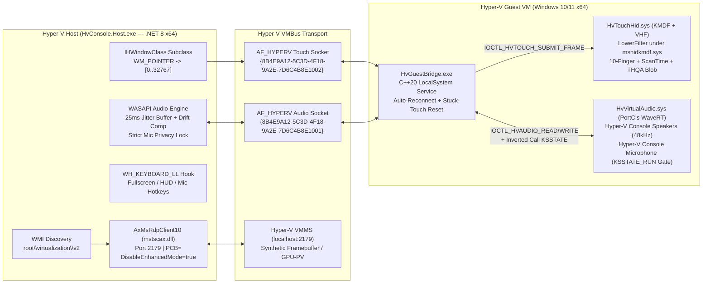

# VMStream — Zero-Artifact Hyper-V Console Client with HVSocket Audio & Multi-Touch HID Bridge

`VMStream` is a two-part Windows Host + Guest solution that replaces `vmconnect.exe` for **strictly Console Session** connections to local Hyper-V virtual machines. It delivers raw synthetic framebuffer / GPU-PV hardware-accelerated video (zero Enhanced Session RDP desktop composition artifacts), distraction-free borderless fullscreen, low-latency 48 kHz WaveRT bidirectional audio (with a strictly privacy-locked microphone), and genuine 10-point Windows 11 multi-touch HID digitizer forwarding over **Hyper-V Sockets (`AF_HYPERV`)**.

---

## 1. Architecture Overview



---

## 2. Repository Structure

```text
VMStream/
├── VMStream.sln
├── Setup-And-Build.cmd                  # One-click UAC-elevating prerequisite installer & full build launcher
├── README.md
├── scripts/
│   ├── Install-BuildPrerequisites.ps1   # Auto-installs .NET 8 SDK, VS 2022 C++ Build Tools, Win11 SDK & WDK
│   ├── Register-HvSocketServices.ps1    # Host script: registers HVSocket GUIDs + SDDL in HKLM
│   ├── Build-All.ps1                    # Bootstraps prerequisites & compiles C# Host, C++ Bridge, and WDK Drivers
│   └── Install-GuestDrivers.ps1         # Guest script: test cert, testsigning, SetupAPI/pnputil, service
└── src/
    ├── Shared/
    │   └── HvProtocol.h                 # Packed binary wire structs, Service GUIDs, and IOCTLs
    ├── Host/
    │   └── HvConsole.Host/              # .NET 8 C# WinForms x64 Host Application
    │       ├── Audio/                   # WASAPI interop, 25ms AdaptiveJitterBuffer, HostAudioEngine
    │       ├── Input/                   # IHWindowClass SetWindowSubclass touch capture & WH_KEYBOARD_LL
    │       ├── Protocol/                # Packed C# wire structs matching HvProtocol.h
    │       ├── Rdp/                     # Native mstscax.dll AxHost Console Session wrapper
    │       ├── Transport/               # Native AF_HYPERV VM-isolated socket listener & TCP fallback
    │       ├── UI/                      # VmPickerForm, ConsoleSessionForm, QuickSettingsHudForm, ToastOverlayForm
    │       └── Wmi/                     # HyperVVmDiscovery (root\virtualization\v2 + GPU-PV detection)
    └── Guest/
        ├── HvGuestBridge/               # C++20 Windows Service connecting AF_HYPERV (HV_GUID_PARENT) to IOCTLs
        ├── HvTouchHid/                  # C++ KMDF + VHF Multi-Touch Digitizer Driver (.inf, .sys)
        └── HvVirtualAudio/              # C++ PortCls/WaveRT Virtual Audio Driver (Speakers + Mic) (.inf, .sys)
```

---

## 3. Key Technical Highlights

1. **Strict Console Session Only (`localhost:2179` + Clean `PCB` GUID):**
   - `RdpConsoleControl` configures `mstscax.dll` with `Server = "localhost"`, `RDPPort = 2179`, `AuthenticationServiceClass = "Microsoft Virtual Console Service"`, `DisableEnhancedMode = true`, and `DisplayConnectionBar = false`.
   - `ExtendedSettings["PCB"]` is formatted via `VmId.ToString("D")` (**strictly without curly braces `{}`**), preventing `vmms.exe` from rejecting the connection on port 2179 with `0x80070057`.
2. **Intercepting `WM_POINTER` Before `mstscax.dll` Converts Touch to Mouse:**
   - Upon `OnConnected`, `TouchWindowInterceptor` enumerates child HWNDs (`EnumChildWindows`) of the RDP ActiveX control, finds `IHWindowClass`, and installs a native subclass (`SetWindowSubclass`).
   - `WM_POINTERDOWN`, `WM_POINTERUPDATE`, and `WM_POINTERUP` for `PT_TOUCH` are normalized to `[0..32767]`, packed into a 64-byte `HV_TOUCH_INPUT_REPORT` (with `Confidence = 1` and `ScanTime` in $100\ \mu\text{s}$ units), sent over `AF_HYPERV`, and swallowed (`return 0`) so `mstscax.dll` never synthesizes legacy mouse clicks.
3. **Windows 11 Precision Multi-Touch Descriptor (`HvTouchDescriptor.h`) + `mshidkmdf.sys`:**
   - `HvTouchHid.inf` registers the in-box `%12%\mshidkmdf.sys` as the function driver and `HvTouchHid.sys` as a `LowerFilters` driver using Microsoft's Virtual HID Framework (`vhf.h`).
   - Implements `EvtVhfAsyncOperationGetFeature` for Report ID `0x02` (`Contact Count Maximum = 10`) and Report ID `0x03` (256-byte THQA Certification Blob `0xFC, 0x28, 0xFE, 0x84, ...`).
   - Includes a sideband control device (`\\.\HvTouchHid`) and automatic **Stuck-Touch Reset** in `HvGuestBridge.exe` whenever the `AF_HYPERV` socket disconnects mid-gesture.
4. **Non-Admin `AF_HYPERV` Binding & Multi-VM Isolation:**
   - `Register-HvSocketServices.ps1` writes `Sddl = "D:(A;;GA;;;AU)(A;;GA;;;SY)(A;;GA;;;BA)"` under `HKLM\SOFTWARE\Microsoft\Windows NT\CurrentVersion\Virtualization\GuestCommunicationServices\<GUID>`, preventing `WSAEACCES (10013)` when `HvConsole.Host.exe` runs without UAC elevation.
   - `HvSocketTransport` binds `SOCKADDR_HV.VmId` to the **exact target VM GUID** (never `HV_GUID_WILDCARD`), allowing multiple VMs to run concurrently in separate windows with isolated audio and touch channels.
5. **Privacy-Locked Microphone + Hardware `KSSTATE_RUN` Gating & Clock Drift Compensation:**
   - Host microphone state defaults to **OFF (LOCKED)** on startup and on every VM connection.
   - When OFF (or when no Guest application has opened `"Hyper-V Console Microphone"` in `KSSTATE_RUN`), `HostAudioEngine` completely releases `IAudioCaptureClient`, `IAudioClient`, and `IMMDevice` via `Marshal.FinalReleaseComObject`, keeping the Windows 11 system tray microphone icon extinguished.
   - `AdaptiveJitterBuffer` targets a **25 ms** playback buffer, dropping 1 stereo frame per 250 frames above **35 ms** and interpolating 1 stereo frame per 250 frames below **15 ms** to eliminate crystal oscillator clock drift (~50–100 ppm).

---

## 4. Zero-Touch Prerequisite Installation & Build

`VMStream` includes an automated toolchain bootstrapper (`scripts\Install-BuildPrerequisites.ps1`, called automatically by `scripts\Build-All.ps1` and `Setup-And-Build.cmd`). If any required compiler or SDK is missing on your machine, it automatically downloads and installs:
1. **.NET 8.0 SDK (x64)** (via `winget` or official Microsoft `dotnet-install.ps1`)
2. **Visual Studio 2022 Build Tools + MSVC v143 x64 C++20 Compiler + Spectre Libraries** (`vs_buildtools.exe`)
3. **Windows 11 SDK (`10.0.22621.0+`)** (`winsdksetup.exe`)
4. **Windows Driver Kit (WDK)** (`wdksetup.exe`) + automatic `WDK.vsix` MSBuild `WindowsKernelModeDriver10.0` extraction

### Building Everything
Double-click **`Setup-And-Build.cmd`** in the repository root, or run from PowerShell:

```powershell
# Full auto-bootstrap + build (C# Host + C++20 Guest Service + WDK Kernel Drivers)
.\scripts\Build-All.ps1 -Configuration Release

# Or install/verify prerequisites standalone
.\scripts\Install-BuildPrerequisites.ps1

# Or build only the C# Host and C++20 Guest Service (skipping WDK drivers)
.\scripts\Build-All.ps1 -Configuration Release -SkipWdkDrivers
```

Compiled artifacts are staged into:
- `build\dist\Host\` (`HvConsole.Host.exe`, `Register-HvSocketServices.ps1`)
- `build\dist\Guest\` (`HvGuestBridge.exe`, `HvTouchHid\`, `HvVirtualAudio\`, `Install-GuestDrivers.ps1`)

---

## 5. Deployment Guide

### Step 1: Prepare the Hyper-V Host
Run `Register-HvSocketServices.ps1` once as **Administrator** on the Hyper-V Host. Pass `-VmNameForDriverPrep` for any Generation 2 VM so Secure Boot is disabled (required by Hyper-V to allow test-signed WDK drivers inside the Guest):

```powershell
.\scripts\Register-HvSocketServices.ps1 -VmNameForDriverPrep "Win11-Dev"
```

> **Note:** If the VM was running when disabling Secure Boot, shut down the VM first (`Stop-VM -Name "Win11-Dev"`), run `Set-VMFirmware -VMName "Win11-Dev" -EnableSecureBoot Off`, and start it again.

### Step 2: Install Drivers & Bridge Service Inside the Guest VM
Copy the contents of `build\dist\Guest\` into the Guest VM and run `Install-GuestDrivers.ps1` as **Administrator**:

```powershell
Set-ExecutionPolicy Bypass -Scope Process -Force
.\Install-GuestDrivers.ps1
```

Reboot the Guest VM once so `bcdedit /set testsigning on` takes effect. After reboot, `HvTouchHid.sys`, `HvVirtualAudio.sys`, and the `HvGuestBridge` `LocalSystem` service start automatically.

### Step 3: Launch `HvConsole.Host.exe` on the Host
You can run `HvConsole.Host.exe` as a standard user (no UAC elevation required once `Register-HvSocketServices.ps1` has applied the `Sddl` policy, provided your account is in the `Hyper-V Administrators` group):

```powershell
# Launch interactive dark-mode VM Picker
.\build\dist\Host\HvConsole.Host.exe

# Connect directly to a VM by Name in Borderless Fullscreen
.\build\dist\Host\HvConsole.Host.exe --vm "Win11-Dev" --fullscreen

# Connect directly to a VM by GUID
.\build\dist\Host\HvConsole.Host.exe --guid "d8a3f120-5c3d-4f18-9a2e-7d6c4b8e1001"
```

---

## 6. Hotkeys Reference

All hotkeys are intercepted via a low-level keyboard hook (`WH_KEYBOARD_LL`) so they work reliably even when the RDP ActiveX console has full keyboard capture:

| Shortcut | Action |
| :--- | :--- |
| `Ctrl + Alt + Pause` *(or `Ctrl + Alt + Shift + F`)* | Toggle **Borderless Fullscreen** $\leftrightarrow$ **Windowed Mode** (zero top connection bar) |
| `Ctrl + Alt + Shift + H` | Toggle the floating **Quick-Settings HUD** (VM stats, `AF_HYPERV` RTT, Speaker Volume/Mute, Mic Privacy Lock) |
| `Ctrl + Alt + Shift + M` | Toggle **Host Microphone Forwarding ON / OFF** with non-activating corner toast indicator |
| `Esc` *(when HUD is open)* | Dismiss the **Quick-Settings HUD** |

---

## 7. Step-by-Step Verification Tests

### Test 1: Verify Guest PnP Devices & Service Status
Inside the Guest VM PowerShell, verify that both WDK drivers and the `HvGuestBridge` service are active:

```powershell
# 1. Verify Virtual Multi-Touch Digitizer (VHF + mshidkmdf)
Get-PnpDevice -PresentOnly | Where-Object { $_.InstanceId -like "ROOT\HIDCLASS\*" -or $_.FriendlyName -like "*Multi-Touch*" } |
    Format-Table Status, Class, FriendlyName, InstanceId -AutoSize

# 2. Verify Virtual Audio Driver & Core Audio Endpoints
Get-PnpDevice -Class MEDIA, AudioEndpoint -PresentOnly | Where-Object { $_.FriendlyName -like "*Hyper-V Console*" } |
    Format-Table Status, Class, FriendlyName, InstanceId -AutoSize

# 3. Verify HvGuestBridge LocalSystem Service
Get-Service -Name HvGuestBridge
```

Expected output:
- `Status = OK` for `"Hyper-V Console Multi-Touch Digitizer (VHF)"`
- `Status = OK` for `"Hyper-V Console Speakers"` and `"Hyper-V Console Microphone"`
- `Status = Running` for `HvGuestBridge`

### Test 2: Verify True Windows 11 Multi-Touch & Anti-Stuck-Touch Recovery
1. Inside the Guest VM, open **Settings $\rightarrow$ System $\rightarrow$ About**: confirm **Pen and touch** reports **`Touch support with 10 touch points`**.
2. Touch and hold on the Guest Windows 11 Desktop for ~500 ms: confirm the **native square/ripple touch indicator** appears and opens the touch-sized right-click context menu.
3. Open Microsoft Edge or File Explorer inside the Guest VM: test **one-finger inertial scrolling (fling)** and **two-finger pinch-to-zoom**.
4. **Stuck-Touch Resilience Test:** While holding two fingers down on the Guest screen, close `HvConsole.Host.exe` (or press `Alt+F4`). Reconnect and verify that `HvGuestBridge.exe` immediately issued `IOCTL_HVTOUCH_RESET_CONTACTS` on socket disconnect so no ghost touches remain depressed.

### Test 3: Measure Audio Latency & Clock Drift Regulation
1. Play a continuous 48 kHz audio/video stream inside the Guest VM (e.g., a 60 fps sync test video).
2. Press `Ctrl + Alt + Shift + H` on the Host to open the **Quick-Settings HUD**.
3. Verify:
   - `Audio Socket : Connected (AF_HYPERV, RTT < 0.50 ms)`
   - `Jitter Buffer: ~24.5 - 25.5 ms (Target 25ms)`
   - Over a 20+ minute playback session, observe the `Drift: -dropped / +duplicated` counters gently incrementing by 1 frame per 250 frames whenever the buffer crosses the 15 ms or 35 ms watermarks, keeping end-to-end latency locked at ~25 ms without underruns.

### Test 4: Verify Host Microphone Hardware Release & Privacy Lock
1. Connect `HvConsole.Host.exe` to a running VM.
2. Check **Windows 11 Settings $\rightarrow$ Privacy & security $\rightarrow$ Microphone** on the **Host** (and the Host system tray):
   - Confirm `HvConsole.Host.exe` is **NOT** listed as "Currently in use" and the Windows system tray microphone icon is **OFF**.
3. Press `Ctrl + Alt + Shift + M` to arm the microphone (`🟡 MICROPHONE ARMED — WAITING FOR GUEST APP`):
   - While no app inside the Guest VM is recording, `HvVirtualAudio.sys` Capture Pin remains in `KSSTATE_STOP`, so `HvConsole.Host.exe` still holds **zero** `IAudioClient` handles and the Host mic tray icon stays **OFF**.
4. Open **Sound Recorder** (or Voice Recorder / Teams) inside the **Guest VM** and click **Record**:
   - `HvVirtualAudio.sys` transitions the Capture Pin to `KSSTATE_RUN` and completes the inverted-call `IOCTL_HVAUDIO_WAIT_STATE_CHANGE`.
   - Within `< 5 ms`, the Host opens `IAudioClient` (`🎙️ MICROPHONE LIVE — STREAMING TO GUEST VM`) and the Host system tray mic icon turns **ON**.
5. Stop recording inside the Guest VM (or press `Ctrl + Alt + Shift + M` to lock the mic):
   - Confirm the Host `IAudioClient` COM object is immediately released via `Marshal.FinalReleaseComObject` and the Host system tray microphone icon disappears within ~1 second.
